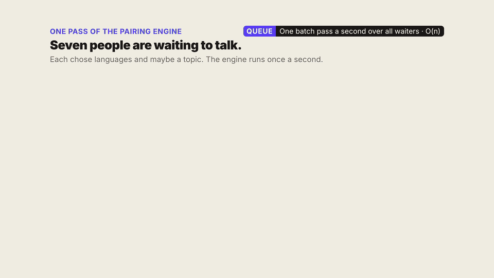

# Fluffle Matchmaking

A prototype of Fluffle's 1:1 matchmaking: two people who are online, share a language and are ready to talk get paired, are shown the match together, and start a call only if both say ready.

- **Back end:** Rust, in memory, one WebSocket per user. Built and tested.
- **Mobile app:** React Native with TypeScript (Expo), in [`mobile/`](mobile/). In progress.

## How pairing works (65-second video)

[](docs/media/pairing-explainer.mp4)

Click the preview for the full-quality video ([docs/media/pairing-explainer.mp4](docs/media/pairing-explainer.mp4)). It is silent.

| Time | What it shows |
|---|---|
| 0:00 | Seven people waiting; the engine runs one pass a second |
| 0:04 | Step 1: group people with exactly the same languages |
| 0:09 | Step 2: a partner request puts that pair first; then a shared topic beats a longer wait |
| 0:20 | Step 3: people left over pair on any shared language, longest wait first |
| 0:27 | The offer: both have 15 seconds; one decline sends the other back to the front |
| 0:40 | After a call: who gets the person still waiting, and the tie-break |

The panel in the top-right corner names the data structure or algorithm behind each step.

Further reading:

- [docs/SYSTEM_DESIGN.md](docs/SYSTEM_DESIGN.md): the algorithm, the decisions, what differs from the brief's defaults, scale numbers, known weaknesses.
- [docs/ARCHITECTURE.md](docs/ARCHITECTURE.md): code layout, the WebSocket protocol, configuration, test suites.

## Run the back end

Needs Rust (stable). Install with [rustup](https://rustup.rs) if `cargo` is missing.

```bash
cd backend && cargo run --release
```

The server listens on port 8080. For a quick demo, shorten the timers:

```bash
cd backend && OFFER_WINDOW_MS=15000 WAIT_BUDGET_MS=120000 TICK_MS=1000 cargo run --release
```

All settings are listed in [docs/ARCHITECTURE.md](docs/ARCHITECTURE.md#configuration). Partner requests are read from [`backend/partner_requests.json`](backend/partner_requests.json).

## Run the tests

Everything (56 tests: ranking rules, offer outcomes, randomised property tests, real-WebSocket tests, scripted scenarios):

```bash
cd backend && cargo test
```

### Scripted scenarios

Readable, repeatable walk-throughs of the rules in section 2 of the brief. Each is a JSON file in [`backend/scenarios/`](backend/scenarios/) listing who does what and when, and what must be true afterwards.

```bash
cd backend && cargo run --bin scenario
```

Sample output:

```
A decline: the decliner leaves, the other goes back to the front  (scenarios/05_decline_requeues_at_the_front.json)
      7.0s  ben declines
      7.0s  ✓ expect ben to be told "left" (declined)
      7.0s  ✓ expect ana to be told "requeued" (partner_declined)
      9.0s  pairing pass
      9.0s  ✓ expect an offer between ana and dana
```

To write your own, copy a file and edit the steps. Available steps: `join`, `leave`, `ready`, `decline`, `end_call`, `block`, `tick`, `expect_offer`, `expect_no_offers`, `expect_phase`, `expect_event`.

### Load tests

How long one pairing pass takes on a big queue (no network):

```bash
cd backend && cargo run --release --bin loadtest -- engine
```

Thousands of real WebSocket clients against a server the tool starts itself. It plays each user through join, offer, answer and call, and fails if anyone was double-matched:

```bash
cd backend && ulimit -n 20000 && cargo run --release --bin loadtest -- network --users 2000
```

The same on a simulated bad network (300 ms round trip plus jitter, more declines and dropped connections):

```bash
cd backend && ulimit -n 20000 && cargo run --release --bin loadtest -- network --users 2000 --latency-ms 300 --jitter-ms 200 --decline-rate 0.10 --drop-rate 0.05
```

Add `--url ws://host:8080` to aim it at a server that is already running. Results from 12 November 2026 are in [docs/SYSTEM_DESIGN.md](docs/SYSTEM_DESIGN.md#8-scale); in short, a pass over 100,000 waiting people took 124 ms, and 8,000 simulated users were matched with no double matches.

## Try it by hand without the app

With the server running, open two terminals and connect two users with any WebSocket client, for example [`websocat`](https://github.com/vi/websocat):

```bash
websocat "ws://localhost:8080/ws?user_id=ana&name=Ana"
```

```bash
websocat "ws://localhost:8080/ws?user_id=ben&name=Ben"
```

In each, paste a join message:

```json
{"type":"join","languages":["english"],"topic":"sports"}
```

Both receive an `offer` within a second. Answer in each with the `match_id` you were sent:

```json
{"type":"respond","match_id":1,"answer":"ready"}
```

Both then receive `call_started`. The full message list is in [docs/ARCHITECTURE.md](docs/ARCHITECTURE.md#websocket-protocol).

## Repository layout

```
backend/           Rust server, engine, tests, scenarios, load tester
mobile/            Expo app (in progress)
docs/              System design, architecture, the explainer video
explainer-video/   Source of the explainer video
```
