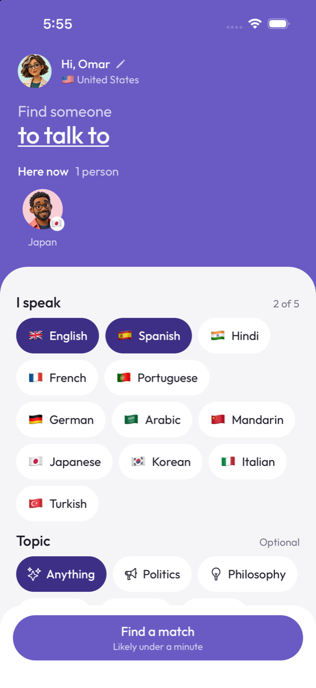
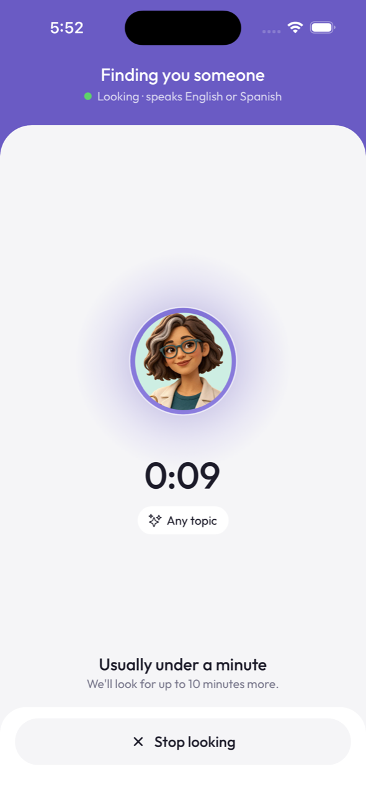
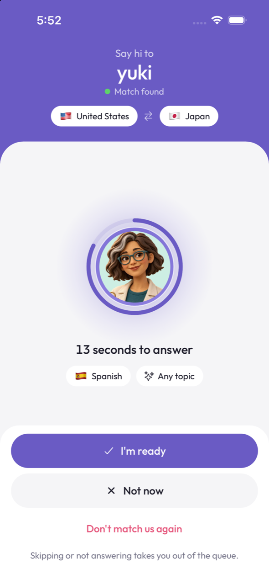
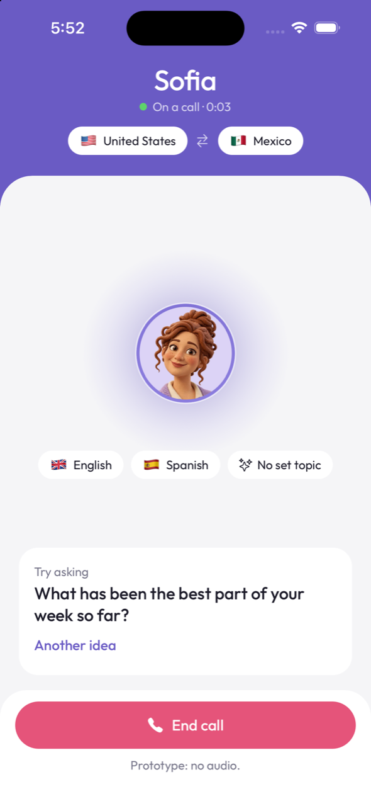

# Fluffle Matchmaking

<p>
  
  
  
  
</p>

## Install

You need:

- [Rust](https://rustup.rs) (stable), for the back end
- [Node.js](https://nodejs.org) 20 or newer, for the app
- An iOS simulator (Xcode) or an Android emulator (Android Studio), or a phone with [Expo Go](https://expo.dev/go)

Then install the app's dependencies:

```bash
cd mobile && npm install
```

## Run

Start the back end. It listens on port 8080.

```bash
cd backend && cargo run --release
```

In a second terminal, start the app:

```bash
cd mobile && npx expo start
```

Press `i` to open it in the iOS simulator or `a` for the Android emulator. On a phone, scan the QR code
with Expo Go; the phone must be on the same Wi-Fi as this computer.

The app finds the back end on port 8080 of the computer running `expo start`. To point it somewhere else:

```bash
cd mobile && EXPO_PUBLIC_SERVER_URL=http://192.168.1.20:8080 npx expo start
```

## Try it with two people

Matching needs two people who share a language. Any of these works:

- **Two simulators:** boot a second simulator, press `shift+i` in the Expo terminal and pick it.
- **A simulator and a phone:** open the project in Expo Go on the phone as well.
- **One simulator and a scripted partner:**

```bash
cd mobile && node scripts/partner.mjs --name Bea --region BR
```

On each device, pick a language you have in common and tap **Find a match**.
