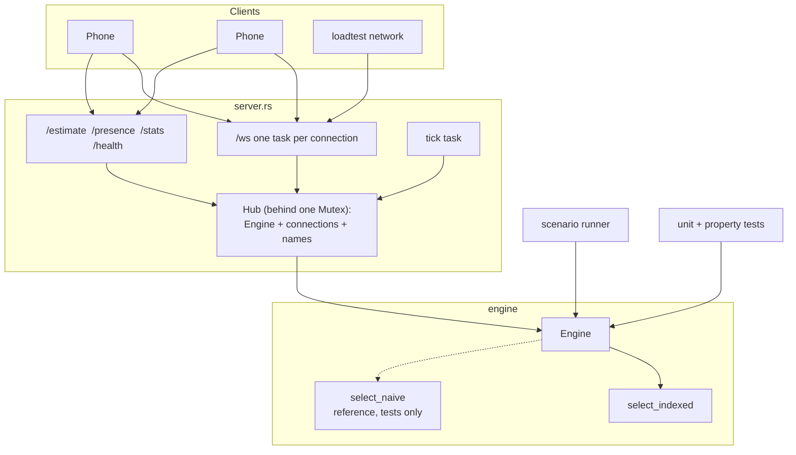

# Architecture

Where the code lives and how the pieces talk. This file is updated as the project is built. For the reasoning behind the design, see [SYSTEM_DESIGN.md](SYSTEM_DESIGN.md).

## Status

| Part | State | Location |
|---|---|---|
| Pairing engine | Built and tested | `backend/src/engine/` |
| WebSocket server | Built and tested | `backend/src/server.rs` |
| Scenario runner | Built, 9 scenarios | `backend/src/scenario.rs`, `backend/scenarios/` |
| Load tester | Built | `backend/src/bin/loadtest.rs` |
| Mobile app (Expo, TypeScript) | In progress | `mobile/` |
| Explainer video | Rendered | `explainer-video/`, `docs/media/` |

## Repository layout

```
backend/
  src/
    engine/
      mod.rs        Engine: state, commands, offers, wait estimate, invariants
      select.rs     Pair selection: the O(n²) reference and the indexed version
      types.rs      Config, events, errors, shared types
    server.rs       HTTP + WebSocket layer around one engine
    scenario.rs     Scripted-scenario format and runner
    main.rs         Server binary (reads env vars and partner_requests.json)
    bin/
      scenario.rs   CLI: run scenario files and print each step
      loadtest.rs   CLI: engine benchmark and network load test
  tests/
    ranking.rs      Who can be paired, who is paired first
    offers.rs       Offer outcomes, wait budget, cooldowns, wait estimate
    properties.rs   Randomised: indexed = reference; nobody doubled or dropped
    network.rs      End-to-end over real WebSockets
    scenarios.rs    Every file in scenarios/ must pass
  scenarios/        One JSON file per scripted scenario
  partner_requests.json
docs/
  SYSTEM_DESIGN.md
  ARCHITECTURE.md
  media/            The explainer video and its GIF preview
explainer-video/    Source of the explainer video (HTML + GSAP)
mobile/             The Expo app
```

## Layers



- **Engine** knows nothing about sockets, threads or real time. It takes commands with a timestamp and returns a list of `Event`s saying who should be told what.
- **Server** owns the engine behind one mutex. Each connection has its own outbound queue, so a slow phone never holds the lock. A separate task calls `tick` every `TICK_MS`.
- **Tests, the scenario runner and the engine benchmark** all drive the same `Engine` directly, with a scripted clock.

## Engine API

| Call | Effect |
|---|---|
| `join(user, languages, topic, now)` | Enter the queue. Returns the starting wait estimate. |
| `leave(user, now)` | Cancel a wait, decline an open offer, or end a call. |
| `respond(user, match_id, answer, never_again, now)` | Answer an offer. |
| `end_call(user, now)` | End a call for both people. |
| `block(user, other, now)` | Never pair these two. Closes an open offer between them. |
| `tick(now)` | Expire offers and waits, pair people, report estimate changes. |
| `estimate(languages, now)` | The estimate for the start screen. |
| `phase(user)`, `stats()` | Read-only views. |
| `check_invariants()` | Verifies nobody is in two places. Used by tests after every step. |

## WebSocket protocol

Connect to `/ws?user_id=<id>&name=<display name>&region=<country code>`. `region` is optional: a two-letter ISO 3166-1 code such as `BR`, shown to the person's match as a flag. All messages are JSON with a `type` field.

**Client to server**

| `type` | Fields |
|---|---|
| `join` | `languages` (1 to 5), `topic` (optional) |
| `leave` | |
| `respond` | `match_id`, `answer` (`ready` or `decline`), `never_again` (optional) |
| `end_call` | |
| `block` | `user_id` |
| `ping` | Send every few seconds; a silent connection is dropped after 30 s |

**Server to client**

| `type` | Fields | Meaning |
|---|---|---|
| `hello` | `user_id`, `state`, `offer_window_ms`, `wait_budget_ms` | Sent on connect. `state` is `{ "phase": "idle" \| "waiting" }` or `{ "phase": "offered" \| "in_call", "match_id": n }` |
| `joined` | `estimate`, `wait_budget_ms` | In the queue |
| `estimate` | `estimate` | The bucket changed while waiting |
| `offer` | `match_id`, `partner`, `partner_name`, `partner_region`, `languages`, `topic`, `expires_in_ms` | Both people get this together |
| `call_started` | `match_id`, `partner`, `partner_name`, `partner_region`, `languages`, `topic` | Both said ready |
| `requeued` | `reason` (`partner_declined`, `partner_timed_out`), `wait_budget_ms` | Back in the queue, place kept |
| `left` | `reason` (`cancelled`, `declined`, `offer_timeout`, `wait_timeout`) | Out of the queue |
| `call_ended` | `match_id`, `reason` (`you_ended`, `partner_left`) | |
| `blocked` | `user_id` | Block recorded |
| `replaced` | | A newer connection for this user took over |
| `error` | `code`, `message` | The request was rejected; the socket stays open |
| `pong` | | |

`estimate` is `{ "bucket": "under_a_minute" | "a_few_minutes" | "over_five_minutes" | "unknown", "sample_size": n, "someone_waiting": bool }`.

Each connection has an outbound queue of 256 messages. A client that stops reading until it fills is disconnected, which frees its place like any other dropped connection.

There is no authentication: `user_id` is whatever the client sends, because sign-up and login are out of scope for the prototype. Anyone who knows a `user_id` can connect as that user.

An `error` with code `no_such_offer` is normal under network delay: the answer arrived after the partner had already declined. Clients should ignore it.

**HTTP**

| Route | Returns |
|---|---|
| `GET /estimate?languages=english,spanish` | The pre-join estimate |
| `GET /presence?languages=english,spanish` | Who is waiting now and shares a language: a count, plus an avatar code and region for the first 12. No names or ids |
| `GET /stats` | Counts of people waiting, open offers, calls, connections |
| `GET /health` | `ok` |

## Configuration

Environment variables read by the server binary:

| Variable | Default | Meaning |
|---|---|---|
| `PORT` | 8080 | |
| `TICK_MS` | 1000 | How often pairing runs |
| `OFFER_WINDOW_MS` | 15000 | Time to answer an offer |
| `WAIT_BUDGET_MS` | 600000 | Maximum wait |
| `DECLINE_COOLDOWN_MS` | 120000 | Gap before re-offering after a decline |
| `RECENT_PARTNER_COOLDOWN_MS` | 300000 | Gap before re-offering after a call |
| `HEARTBEAT_TIMEOUT_MS` | 30000 | Silence before a connection is dropped |
| `PARTNER_REQUESTS` | `partner_requests.json` | File of `{ languages, topic? }` entries |

## Test suites

| Suite | What it proves | Tests |
|---|---|---|
| `ranking.rs` | Eligibility and each ranking rule, one test per rule | 18 |
| `offers.rs` | Every offer outcome, budgets, cooldowns, the estimate rule | 26 |
| `properties.rs` | 2,000 random queues: indexed selection equals the reference. 1,500 random command sequences: nobody in two places, nobody dropped silently, no blocked pair offered | 2 |
| `network.rs` | The full flow over WebSockets, disconnects, heartbeat, a client that never reads, 100 people joining at once | 9 |
| `scenarios.rs` | All scripted scenarios pass | 1 |

## Change log

- **2026-11-12** Engine, server, scenario runner, load tester and all test suites built. A property test found that blocking someone during an open offer left the offer open; fixed so the block closes it.
- **2026-11-13** Fixes from code review on PR 1. The outbound queue per connection is now bounded. A wait is counted once per person per call, not once per shared language. Estimate updates are sent only when the bucket changes. The scenario runner clears stale events after a failed command and stops on an invariant failure. The requeue-seniority test was rewritten because the old one passed whether or not seniority was kept. `PORT` is validated.
