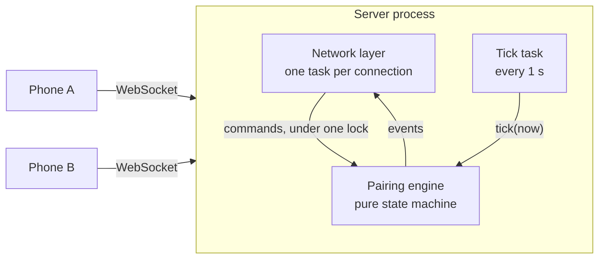
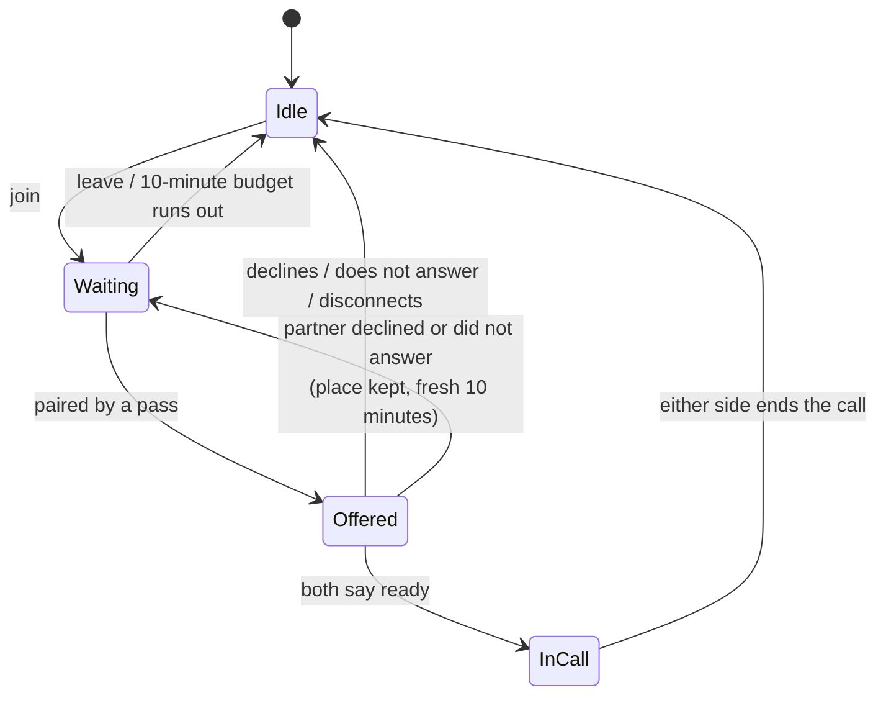

# System design: Fluffle matchmaking

This document explains how pairing works and why it is built this way. For where the code lives, see [ARCHITECTURE.md](ARCHITECTURE.md).

## 1. What the system does

People join a queue with 1 to 5 languages and an optional topic. The system pairs two people who share a language, shows both the match at the same moment, and starts a call only if both say ready within 15 seconds.

The hard requirements, from section 2 of the brief:

- Two people are paired only if they share a language, neither has blocked the other (or said "don't match me again"), and neither already has an offer open.
- Pairing follows a strict priority: exact same language set, then partner demand, then shared topic, then longest wait.
- When many people join at once, nobody ends up in two matches and nobody is dropped.

## 2. The shape of the solution

Three decisions carry the design:

1. **One engine, one lock.** All state lives in one `Engine` value. Every command (`join`, `respond`, `leave`, `tick`) runs to completion while holding one lock. There is no moment where a person is half-moved between states, so "in two matches" cannot happen.
2. **The engine has no clock and no I/O.** Every call receives `now`. Tests set the time exactly, so a 10-minute timeout is tested in microseconds and every run is repeatable.
3. **Pairing runs in a short batch, not on every join.** Once a second the engine looks at everyone waiting and pairs them best-first. This is what makes the ranking rules apply at all (see section 4).

## 3. A user's life cycle

A user is in exactly one of these states. The engine stores it as one `Slot` per user, so being in two is not representable.

## 4. The pairing algorithm

### What it must compute

Take every pair of waiting people who are allowed to be paired. Sort those pairs best-first by this key, then take pairs from the top, skipping anyone already taken:

| Priority | Rule | Notes |
|---|---|---|
| 1 | Exact same language set | Before any pair that only overlaps |
| 2 | Partner request for the shared languages | Higher still if the request names a topic both picked |
| 3 | Both picked the same topic | Topic is a preference, never a filter |
| 4 | Longest wait in the pair | Then the other person's wait |
| 5 | Join order | Only for exact ties; each join gets a sequence number |

Because the order is strict (a lower rule never outranks a higher one), this "best pair first" procedure is the definition of correct, not an approximation. `select_naive` in the code is this paragraph written out, and costs O(n²).

### How it is computed quickly

`select_indexed` returns the same pairs in the same order without comparing everyone with everyone. It walks the ten ranking classes from best to worst. For each class it looks people up through a list that is guaranteed to contain every pair of that class:

| Class of pair | Looked up through |
|---|---|
| Exact set, with or without a shared topic | Hash map keyed by (language set, topic) or by language set |
| Overlap matching a partner request | List of people who speak every requested language |
| Overlap with a shared topic | List per (language, topic) |
| Any other overlap | List per language (a person appears in at most five) |

Every list is kept in wait order, so the best partner for a person is the first valid entry after them. A property test generates thousands of random queues and checks the fast and slow versions return identical results.

### Why a one-second batch

If pairing ran the instant each person joined, the queue would almost never hold a choice: English-only would be paired with English + Spanish the moment the second arrived, even if an exact match came 200 ms later. A one-second pass costs at most a second of waiting, which nobody notices, and lets the ranking see everyone who arrived in that second. It also makes "many people join at once" deterministic.

## 5. The offer

- Both people get the offer in the same engine step, with the same `expires_in_ms`. The server sends time remaining, not a timestamp, so a phone with a wrong clock still shows a correct countdown.
- Both ready: the call starts.
- One declines: the offer closes at once. The decliner leaves the queue. The other returns to the queue with their original place and a fresh 10 minutes.
- The window closes: whoever did not answer leaves. Someone who said ready is requeued. If neither answered, both leave.
- An answer that arrives after the window closed is rejected, even if the pass that expires the offer has not run yet.

"Place" and "budget" are two separate clocks. `seniority` (when the person first joined) decides ranking and is kept on requeue. `deadline` decides the 10-minute timeout and is reset. That is what "back to the front with a fresh wait budget" means.

## 6. The wait estimate

One rule, in one place (`engine/mod.rs`, "wait estimate"):

- **Before joining:** if someone who shares a language is waiting right now, "under a minute". Otherwise the median of real waits from the last 30 minutes for those languages.
- **Fewer than three recent waits:** unknown. The app hides the estimate and says it has no data. It never invents a number.
- **While waiting:** the same median, but never a bucket the person has already outlasted. After a minute of waiting it will not say "under a minute".
- Updates are sent only when the bucket changes.

## 7. Deliberate differences from the brief's defaults

| Choice | Default in the brief | What this does | Why |
|---|---|---|---|
| When pairing runs | Not specified | Batch pass every second (`TICK_MS`) | Makes rule 1 (exact set first) apply in practice |
| Partner request match | "for that language set" | The pair's shared languages must equal the request's set | It is the label the call gets, so it is what the partner receives |
| Decline timing | Not specified | A decline closes the offer immediately | No reason to make the other person watch the countdown |
| After a plain decline | Not specified | The two are not re-offered each other for 2 minutes | Otherwise the same offer can come straight back |
| After a call | Not specified | The two are not re-offered each other for 5 minutes | See below |
| Block during an open offer | Not specified | Treated as "decline, don't match again" | An offer between blocked people must not stay open |
| Disconnect | Not specified | Same as leaving; silent connections are dropped after 30 s | Stops offers going to phones that are gone |

**Why the post-call cooldown exists.** Ana and Ben (English + Spanish) finish a call while Carl (English) waits. Both rejoin. Exact-set-first would pair Ana with Ben again and leave Carl waiting, which is bad for Carl and gives Fluffle a second recording of the same two people. With the cooldown, Carl is paired with whichever of them rejoined first.

## 8. Scale

Measured on 12 November 2026 on an Apple M4 Pro laptop, release build.

**One pairing pass, no network** (`loadtest engine`):

| People waiting | Indexed pass | Reference O(n²) pass |
|---|---|---|
| 1,000 | 0.6 ms | 15.8 ms |
| 5,000 | 2.7 ms | 512.6 ms |
| 20,000 | 10.1 ms | not run |
| 100,000 | 124.1 ms | not run |

**Real WebSocket clients against a local server** (`loadtest network`, 250 ms tick):

| Run | Join to first offer (p50 / p99) | Double matches |
|---|---|---|
| 8,000 users, clean network | 132 ms / 255 ms | 0 |
| 2,000 users, 300 ms round trip + jitter, 10% decline, 5% drop | 770 ms / 1,116 ms | 0 |

These runs put clients and server on one machine, so they measure the server's behaviour under load and delay, not real internet conditions.

### Growing beyond one process

- The queue holds only people waiting right now, so it stays small even with a large user base. One matcher handles 100,000 simultaneous waiters with time to spare inside a one-second pass.
- Phones would connect to stateless gateway servers near them; gateways forward commands to the single matcher. Matching does not need to be near the user because the one-second pass dominates any network delay. Call audio does, and is out of scope.
- If one matcher were ever not enough, shard by language cluster and add a conflict resolver for people who span shards.

## 9. Known weaknesses

- **Starvation.** Wait time is the last rule, so someone with only a partial overlap can keep losing to newer exact matches until the 10-minute timeout. The fix is aging: promote a person a tier after a set wait.
- **Greedy can strand scarce languages.** Two English + Swahili speakers pair with each other (exact set), leaving an English-only and a Swahili-only speaker unmatched, when pairing across would have matched all four. The brief's order requires this.
- **Partner requests never switch off.** A real system would deactivate a request once its hours are collected.
- **One process, in memory.** A restart empties the queue; clients must rejoin. The brief allows this.
- **Estimates are weakest for rare languages**, which is where people most need them.

## 10. What comes next with one more day

1. Aging, to bound starvation without a timeout.
2. A reliability signal: rank down people who repeatedly decline or let offers lapse.
3. A reconnect grace period, so a brief signal loss does not cost a place in the queue.
4. Estimates that account for time of day.
